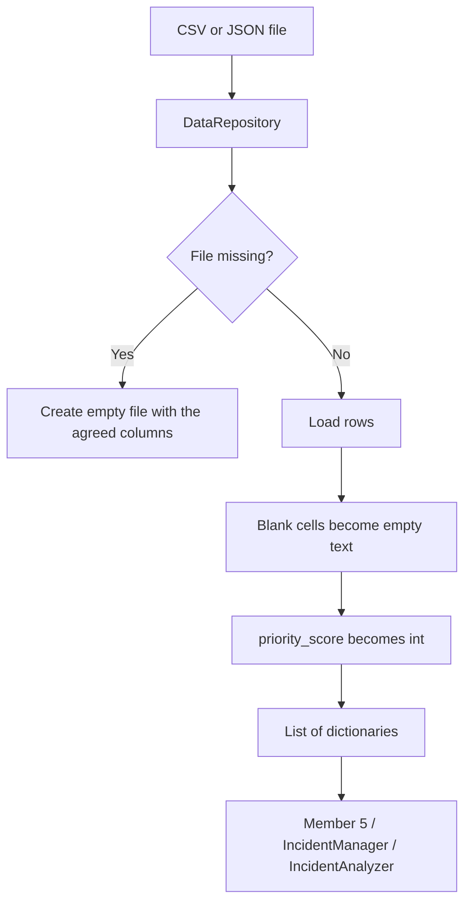

# Member 4 - Data Management and Pandas Analytics

Files: `member4_data_analytics.py` (code), `test_member4_data_analytics.py` (tests), `data/` (synthetic files).
Run the tests: `python -m unittest -v test_member4_data_analytics`
Rebuild the dataset: `python member4_data_analytics.py`

The code stores reports and summarises them. It does not confirm that an attack happened. All generated rows are simulated.

## 1. Shared schema (same as Member 1)

Incident: incident_id, reported_at, category, description, severity, urgency, affected_scope, priority_score, status, reviewed_at, resolution.

Action: action_id, incident_id, action_type, action_time, note.

Allowed values are imported from `member1_incident_core.py`. Status values are Submitted, Under Review, Resolved, Closed. That is the team contract. Do not use New or Dismissed.

Formats:
- Incident ID `INC-1001`. Action ID `ACT-0001`. Quiz result ID `RES-0001`.
- Dates: `DD/MM/YYYY HH:MM AM/PM`, for example `12/10/2026 10:30 AM`.
- `priority_score` is a Python `int` (CSV text is converted on load).
- Blank `reviewed_at` and `resolution` are `""`, not NaN.

Quiz results (Member 4 prepares the synthetic file; Member 3 owns questions):

| Field | Meaning |
|---|---|
| result_id | unique result identifier |
| participant_code | anonymous code such as P-0001 |
| quiz_stage | pre-training or post-training |
| quiz_date | completion timestamp |
| score | number of correct answers |
| total_questions | number of questions in that attempt |

Articles and quiz questions are loaded through the same repository. Member 3 fills `data/articles.json` and `data/quiz_questions.json`. Member 4 ships empty lists so missing files do not crash the app.

## 2. Storage



Default folder: `data/` next to this module.

| File | Role |
|---|---|
| incidents.csv | source of truth for incidents |
| incidents.json | same incident rows, JSON copy |
| incident_actions.csv | review history |
| incident_actions.json | JSON copy of actions |
| quiz_results.csv | synthetic quiz attempts |
| quiz_results.json | JSON copy of quiz attempts |
| dirty_incidents.csv | invalid rows for cleaning tests only |
| articles.json | empty until Member 3 adds articles |
| quiz_questions.json | empty until Member 3 adds questions |

`dirty_incidents.csv` must not be loaded into `IncidentManager`. It exists to show cleaning.

Saves write a temporary file first, then replace the target. CSV/JSON files are not a database: two people saving at the same time can overwrite each other.

## 3. Cleaning rules

`IncidentAnalyzer.clean_data()` is used before KPIs. The dashboard must not treat invalid dates as real review times.

| Problem | Rule |
|---|---|
| Completely empty row | Drop. |
| Missing required field | Drop. Required: incident_id, reported_at, category, description, severity, urgency, affected_scope, status. |
| ID not like INC-123 | Drop. |
| reported_at not in the team date format | Drop. |
| reviewed_at present but invalid | Clear it to `""`. Keep the row for counts. Exclude it from average review time. |
| Category, status, severity, urgency, or scope not in the Member 1 lists | Drop. |
| priority_score missing or not matching severity + urgency | Recalculate with Member 1's rule. |
| Duplicate incident_id | Keep the first row. |
| reviewed_at earlier than reported_at | Keep the row. Exclude that pair from average review time. |

Duplicate criterion: the same `incident_id`. Same description with a different ID is not treated as a duplicate.

## 4. Metric definitions

Unresolved statuses: **Submitted** and **Under Review**.

Resolved for counting purposes: **Resolved** and **Closed**.

| KPI | Definition |
|---|---|
| Total incidents | Rows left after cleaning and after the selected filters. |
| Unresolved incidents | Rows whose status is Submitted or Under Review. |
| Unresolved percent | unresolved / total * 100. Numerator and denominator are the filtered dataset. If total is 0, the value is None. |
| Average review hours | Mean of (reviewed_at − reported_at) in hours, only where both timestamps parse and the difference is not negative. If none remain, the value is None, not 0. |
| Incidents by category / status / severity | groupby size on the filtered dataset. |
| Trend | Number of reports grouped by month (default), week, or day using reported_at. |
| Recurring categories | Category counts sorted high to low. |
| Average quiz score | Mean of (score / total_questions * 100) on valid quiz rows. |

Filters (all optional): `date_from`, `date_to`, `categories`, `statuses`, `severities`. Dates may be `DD/MM/YYYY` or the full team timestamp. They apply to `reported_at`.

Empty filtered datasets return zeros, empty tables, and a clear message. They do not raise.

Limitations:
- Synthetic rows are not evidence of real attacks or real campus risk.
- A higher post-training quiz score does not prove that incidents decreased.
- Changing filters changes every related KPI and chart dataset.
- Average review time uses the stored first-review timestamp from Member 1, not later status changes.

## 5. Functions used by the team

| Function | Input | Output |
|---|---|---|
| `DataRepository().load_incidents()` | optional path | list of incident dictionaries |
| `DataRepository().save_incidents(incidents)` | Incident objects or dictionaries | saved file path |
| `DataRepository().load_actions()` / `save_actions(actions)` | optional path / action dictionaries | records or path |
| `DataRepository().load_articles()` | optional path | article dictionaries, currently `[]` |
| `DataRepository().load_quiz_results()` | optional path | quiz result dictionaries |
| `IncidentAnalyzer().clean_data(records)` | records or DataFrame | `(cleaned DataFrame, cleaning report)` |
| `IncidentAnalyzer().get_dashboard_metrics(records, filters=None, quiz_results=None)` | records, optional filters, optional quiz rows | KPI dict, chart tables, insights |
| `IncidentAnalyzer().export_summary(metrics, path)` | metrics dict, CSV path | summary CSV |

`get_dashboard_metrics` always cleans first, then filters, then aggregates.

Chart tables for Member 5:
- `by_category`: columns category, count
- `by_status`: columns status, count
- `by_severity`: columns severity, count
- `trend`: columns period, count
- `filtered_incidents`: cleaned, filtered DataFrame for the dashboard table

Example:

```python
repo = DataRepository()
analyzer = IncidentAnalyzer(repo)
metrics = analyzer.get_dashboard_metrics(
    repo.load_incidents(),
    filters={"categories": ["Phishing / Suspicious Message"]},
    quiz_results=repo.load_quiz_results(),
)
```

Load into Member 1 after a file load:

```python
from member1_incident_core import IncidentManager
from member4_data_analytics import DataRepository, incidents_from_records

repo = DataRepository()
manager = IncidentManager(
    incidents_from_records(repo.load_incidents()),
    repo.load_actions(),
)
```

## 6. Notes for the other members

- **Member 1.** Saving is not done in the incident module. After `add_incident` or `update_status`, Member 5 should call `save_incidents(manager.incidents)` and `save_actions(manager.actions)`.
- **Member 2.** Dates are text. Sorting them as strings is wrong. Convert with `parse_app_datetime` or `pd.to_datetime(column, format="%d/%m/%Y %I:%M %p")`.
- **Member 3.** Create `articles.json` and `quiz_questions.json`. Keep quiz result field names if you add real attempts. Participant codes stay anonymous.
- **Member 5.** Call `get_dashboard_metrics`. Do not recalculate KPIs in the page. Use `st.bar_chart(metrics["by_category"].set_index("category"))` and `st.line_chart(metrics["trend"].set_index("period"))`. Show `metrics["insights"]`. If `metrics["is_empty"]`, show `metrics["message"]`. Export with `export_summary` or `repo.export_incidents`.

## 7. AI-use log (Member 4)

AI helped draft the repository, cleaner, KPI functions, tests, and this file against the system design and Member 1 contract. The schema, status names, date format, priority rule, and unresolved definition were copied from Member 1, not invented. Tests were run locally. Synthetic descriptions were written as simulated campus examples with no live links and no passwords.
